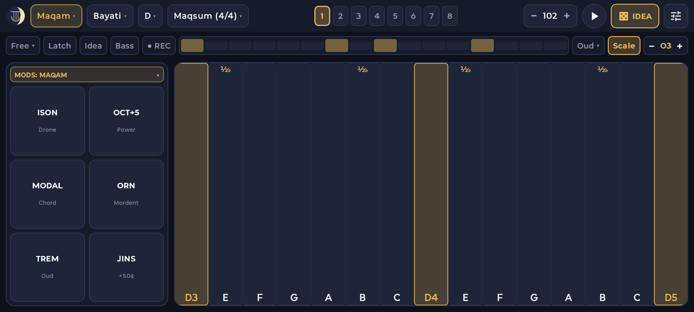
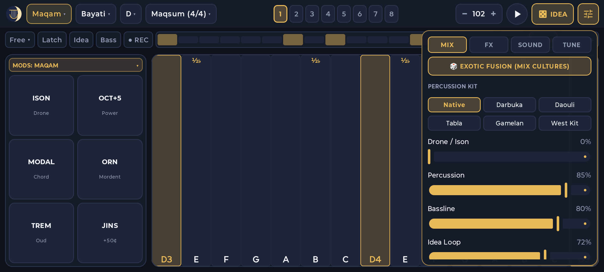

<p align="center">
  
</p>

<h1 align="center">Euterpe</h1>

<p align="center">
  Cross-cultural musical idea generator &amp; tactile Android performance instrument<br/>
  <strong>Kotlin + Jetpack Compose · Google Oboe (C++17) · YAWN DSP · Embedded Lua 5.4</strong><br/>
  <a href="https://tkleisas.github.io/euterpe/">Project site</a> ·
  <a href="https://tkleisas.github.io/euterpe/privacy.html">Privacy policy</a> ·
  <a href="https://github.com/tkleisas/euterpe/releases">Releases</a>
</p>





Inspired by the immediacy of the Telepathic Instruments Orchid (left-hand structural modifiers + 2-octave keyboard), Euterpe expands beyond Western harmony into **Arabic/Levantine Maqams**, **Greek Dromoi**, **Indian Ragas**, **Indonesian Gamelan**, **Exotic/Microtonal scales**, as well as **Techno**, **Metal**, and **Pop**—complete with **synthesized world percussion**, **automatic bassline & melodic idea generation**, **optional Insert & Master FX**, and **8 selectable per-instrument overdub layers**.

---

## Highlights

* **8 Genres & Musical Traditions (Freely Cross-Mixable):**
  * **Arabic / Levantine Maqam:** Bayati, Rast, Hijaz, Hijaz Kar, Saba, Kurd, Nahawand, Segah, Persian Shur & Chahargah, Turkish Hüseyni, 17-TET Neutral.
  * **Greek Dromoi:** Ousak, Hitzaz, Hitzazkiar, Niavent, Greek Rast, Houzam, Sabah, Pireotikos, Hungarian Gypsy.
  * **Indian Raga:** Yaman, Bhairav, Bhimpalasi, Bageshri, Todi, Ethiopian Tizita & Anchihoye.
  * **Indonesian Gamelan:** Sléndro, Pélog Bem, Pélog Barang, Pélog 7, Japanese Hirajoshi / In-Sen / Iwato.
  * **Western, Techno, Metal & Pop:** Major, Minor, Dorian, Lydian, Mixolydian, Pentatonic Minor, Harmonic 7th JI, Prometheus Mystic.
* **Asymmetric Cycle Sequencer & Synthesized World Percussion:**
  * 20 pure-C++ synthesized percussion voices (Darbuka Dum/Tak/Ka/Slap, Bendir, Daouli, Riq, pitch-bending Tabla Bayan & tonic-tuned Dayan/Tik, Gamelan Gong Ageng/Kempul/Kenong/Kendang, Western Kick/Snare/Hat/Clap).
  * Asymmetric meters & cycles: 9/8 Zeibekiko (`2+2+2+3`), 7/8 Kalamatianos (`3+2+2`), 10/8 Samai Thaqil, 11/8 Balkan Kopanitsa, 5/8 Paidushko, 13/8 Murabba, 16-beat Teentaal, 10-beat Jhaptaal, 7-beat Rupak, 14-beat Dhamar, Gamelan Lancaran/Ketawang, Techno 4x4, Metal Gallop, Pop Beat, and Euclidean `E(5,13)`.
  * **Swappable Percussion Kits** (`Native`, `Darbuka`, `Daouli`, `Tabla`, `Gamelan`, `West Kit`) + **Tap-to-Edit** steps in the live Cycle Bar.
* **21 Curated Sound Presets Across 6 YAWN DSP Engines:**
  * **Karplus-Strong:** Oud, Bouzouki, Sitar, Kanun/Harp, Metal Guitar.
  * **FM Synth:** Gamelan Saron, Balinese Bell, FM Techno Bass.
  * **Electric Piano:** Rhodes EP, Wurlitzer EP, Suitcase EP.
  * **Wavetable Synth:** Ney/Wind, Harmonic Pad, Pop Pluck.
  * **Subtractive Synth:** Analog Duduk, Acid TB-303, Deep Sub Bass, Synth Brass.
  * **Polivoks 1982:** Polivoks Lead, Polivoks Acid, Polivoks Pad.
  * Live **Tone/Cutoff**, **Decay/Release**, **Resonance/Drive** sliders + **WARM / ACID / GRIT / DREAM** 1-tap macro variations.
* **Orchid-Style Performance Surface:**
  * **2-Octave Multitouch Keyboard** (`O0`–`O7` full 8-octave range) toggleable between **Scale-Locked** and **12-Key Piano** with `½♭`/`¢` microtonal badges.
  * **Independent Left-Hand Modifier Bank** (`MODS: ...`) — mix Western chords, Maqam ison/ornaments, Raga tanpura/taan, Gamelan kotekan/ombak, Techno 303 roll, or Metal gallop over *any* scale or rhythm.
  * **Performance Modes:** `Free`, `Strum`, `Arp`, 2-bar `Phrase`, plus `Latch`.
  * **Sandboxed Lua 5.4 Idea & Bassline Generator** (`🎲 IDEA` & `🎲 Exotic Fusion`) + per-degree **Microtonal Cents Tuner**.
  * **8 Selectable Overdub Layers (`1`–`8`):** Tap any layer button in the top bar to switch to that part (each layer remembers its own sound preset, Tone/Decay/Drive, and Insert FX); tap **`● REC`** to record/overdub into that slot, and **long-press** any recorded layer to mute/unmute it live.
  * **Optional Insert & Master FX (`FX` tab):** Insert **Tube Drive**, **Stereo Chorus**, and BPM-synced **Ping-Pong Delay** (captured into recorded layers), plus **Master Reverb** and **Glue Compressor** ahead of the safety limiter.

---

## Architecture

```text
Kotlin + Jetpack Compose (Landscape UI)
  ├── EuterpeViewModel / MusicCatalog
  └── EuterpeEngine (JNI)
        │
        ▼
C++17 Native Audio Engine (Google Oboe)
  ├── EventQueue (lock-free UI -> audio thread)
  ├── PerformanceLayer (voicings, strums, arps, 2-bar phrases, kotekan, acid roll, gallop)
  ├── CycleSequencer (asymmetric meters + Lua melodic idea + dedicated bassline)
  ├── WorldPercussionSynth (20 modal/physical percussion voices + 6 swappable kits)
  ├── LoopRecorder (8-layer stereo overdub looper)
  ├── LuaIdeaHost (sandboxed Lua 5.4: assets/generator/euterpe_catalog.lua & euterpe_ideas.lua)
  └── Vendored YAWN DSP (KarplusStrong, FMSynth, ElectricPiano, Wavetable, Subtractive, Polivoks, Reverb, Limiter)
```

---

## Build & Test

Requirements:
* JDK 17+ (e.g., Android Studio JBR)
* Android SDK (`compileSdk 36`), NDK `27.2.12479018`, CMake `3.22.1`

```bash
# 1. Run host-compiled native C++ DSP & Lua unit tests
./native-tests/run.sh

# 2. Run JVM unit tests & build debug APK
./gradlew :app:testDebugUnitTest :app:assembleDebug

# 3. Install to connected Android device
adb install -r app/build/outputs/apk/debug/app-debug.apk
```

Versioning is derived automatically from Git tags (`git describe --tags --always`).

---

## License

Euterpe is licensed under the **GNU General Public License v3.0 (GPL-3.0)** — see [LICENSE](LICENSE).

Third-party components:
* **Google Oboe**: Apache-2.0
* **YAWN DSP subset**: MIT
* **Lua 5.4**: MIT
* **nlohmann/json**: MIT
